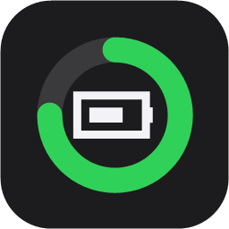
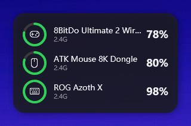

<p align="center">
  
</p>

<h1 align="center">BatteryRings</h1>

<p align="center">
  A desktop widget that shows the battery of your wireless mice, keyboards, controllers and headsets on Windows,
  inspired by the macOS "Batteries" widget.<br>
  <a href="README.md">中文</a> | English
</p>

<p align="center">
  
</p>

## Features

- **All devices in one widget**: Bluetooth devices and 2.4G receivers that Windows itself cannot read
- **No drivers, no admin rights**: uses the PowerShell that ships with Windows, < 100 KB
- **Safe**: only sends known read-only queries, never changes device settings
- **Charging detection**: shown when the device reports it, otherwise inferred from a rising level
- **Low battery alerts**: Windows notification below a threshold you choose
- **Dark / light appearance**: follows the system automatically; size and opacity are adjustable
- **Thoughtful**: last known level while a device sleeps, refreshed as soon as you touch the mouse or keyboard; hover the tray icon to see all levels; starts with Windows
- **Automatic updates**: notifies you about new versions and updates with one click
- **Chinese / English UI**: follows the system language, switchable from the menu

## Supported devices

| Type | Devices | Charging | Notes |
|---|---|---|---|
| Bluetooth / BLE | headsets, mice, keyboards, controllers … | inferred | same value as in Windows Settings |
| Logitech | Unifying / Bolt / Lightspeed receivers, wired and Bluetooth mice and keyboards (MX, G series …) | ✅ | 🧪 needs testing |
| Razer | HyperSpeed wireless mice and keyboards (Viper, DeathAdder, Basilisk, BlackWidow …) | ✅ | 🧪 needs testing |
| Sony PlayStation | DualSense, DualSense Edge, DualShock 4 (USB / Bluetooth) | ✅ | 🧪 needs testing |
| ASUS ROG | mice and keyboards on the Omni receiver (Harpe, Keris, Gladius, Azoth, Strix Scope, Falchion …) | ✅ | 2.4G |
| Compx / Nordic mice | ATK, VXE, VGN, Scyrox, Dareu, G-Wolves, Zaopin … | ✅ | 2.4G and wired |
| 8BitDo | Ultimate 2 … | inferred | 2.4G |
| C-Media headsets | USB headsets using the C-Media XearONE driver | ✅ | experimental |
| XInput controllers | Xbox and compatible | inferred | Windows only reports 4 levels (approx.) |
| Laptop | built-in battery | ✅ | |

**Charging:** ✅ = reported by the device. *Inferred* = the protocol has no charging flag; a level that rises by 2 points or more within 30 minutes is shown as "Charging (inferred)", 100 % then shows "Full".

**🧪 Needs testing:** implemented from mature open-source projects (Solaar, OpenRazer, the Linux kernel), but not yet tested on real hardware. If you own one of these devices, please report in the [issues](../../issues) whether it works and attach the `-Diag` output.

Device missing? See [adding a device](#adding-a-device).

## Install

**Requirements**: Windows 10 or 11. Nothing else.

1. Download the latest `BatteryRings.zip` from [Releases](../../releases)
   (or the green **Code** button → **Download ZIP**)
2. Right-click the ZIP → **Extract All**
3. Double-click **`Install.cmd`** in the extracted folder
   - "Open File - Security Warning" → **Run**
   - "Windows protected your PC" → **More info** → **Run anyway**
4. Press Enter when asked about starting with Windows (default: yes)

The widget appears in the top-right corner. It is also in the Start Menu as **BatteryRings**.

> Installed to `%LOCALAPPDATA%\Programs\BatteryRings` for the current user only. You can delete the extracted folder afterwards.

## Usage

| Action | Result |
|---|---|
| Drag with the left button | move the widget (position is remembered) |
| Right-click the widget or the tray icon | settings menu (below) |
| Left-click the tray icon | bring the widget to the front |
| Hover the tray icon | all battery levels |
| Hover a device | full name and data source |

### Settings

| Menu | Options | Default |
|---|---|---|
| Appearance | Follow system / Dark / Light | Follow system |
| Size | Small / Medium / Large | Medium |
| Opacity | 60 / 75 / 85 / 100 % | 85 % |
| Refresh interval | 5 s / 10 s / 30 s / 1 min / 5 min / custom (5–3600 s) | 1 min |
| Low battery alert | Off / 10 / 20 / 30 % | 20 % |
| Hide devices | tick devices to hide | none |
| Show sleeping devices | on / off | on |
| Lock position | on / off | off |
| Always on top | on / off | off (stays behind other windows) |
| Start with Windows | on / off | chosen during install |
| Language | Auto / 中文 / English | Auto |
| Check for updates / automatically | check now / on / off | on (once a day) |

2.4G receivers do not answer while the device sleeps; the last known level is shown in grey.

## Performance

| Metric | Value |
|---|---|
| Memory (as shown in Task Manager) | about 25 MB |
| CPU | 1 min interval: about 0.16 % of one core; 5 s interval: about 0.9 % |
| Disk / network | network only to check github.com for updates (once a day, can be turned off); settings written at most once a minute, a few KB |

Devices are read on a background thread, so the UI never freezes. To keep fast refresh cheap:

- **Instant refresh on device changes**: a receiver plugged in or a Bluetooth device connected shows up within 1–2 s
- **Sleeping devices refresh on input**: while a device sleeps, touching the mouse or keyboard asks it again right away; if it stays asleep, retries back off from 3 s to 60 s
- **Cached device list**: re-enumerated only when devices change
- **Back-off for sleeping devices**: a device that did not answer is not waited for again for 15 s
- **No redraw when nothing changed**, and no repeated file writes

## Updates

The widget checks GitHub for a new release once a day. When one is available you get a notification and **⬆ Update to vX.Y.Z** appears at the top of the menu; one click downloads, installs and restarts it, keeping your settings. Turn off "Check for updates automatically" in the menu if you prefer.

## Uninstall

Start Menu → **Uninstall BatteryRings**, or double-click `Uninstall.cmd` in the extracted folder.

## Command line

```powershell
cd "$env:LOCALAPPDATA\Programs\BatteryRings"
powershell -ExecutionPolicy Bypass -File .\BatteryRings.ps1           # print once
powershell -ExecutionPolicy Bypass -File .\BatteryRings.ps1 -Watch    # refresh every 30 s
powershell -ExecutionPolicy Bypass -File .\BatteryRings.ps1 -Json     # JSON for other programs
powershell -ExecutionPolicy Bypass -File .\BatteryRings.ps1 -Diag     # diagnostics for bug reports
```

More options: `-Lang zh|en`, `-NoGatt` (skip BLE GATT, faster), `-ProbeCMedia`.

## FAQ

**A device shows "Asleep / offline"** — move the mouse or press a key, then right-click → Refresh now.

**A Bluetooth device is missing** — check Windows Settings → Bluetooth & devices. If no battery is shown there, the device does not report it to Windows.

**Antivirus warning** — the app is plain-text PowerShell; every line can be read. Some antivirus products flag hidden PowerShell windows; add an exception.

## Adding a device

Each protocol is a single file in [`src/providers/`](src/providers).

- **Users**: create a diagnostics file as described in [CONTRIBUTING.md](docs/CONTRIBUTING.md#english) and open an [issue](../../issues/new)
- **Developers**: see [PROTOCOLS.md](docs/PROTOCOLS.md); capture traffic with [`tools/hidapi_proxy`](tools/hidapi_proxy)

## Credits

Protocol facts (no code) from:

- [seerge/g-helper](https://github.com/seerge/g-helper) — ASUS ROG peripherals
- [pwr-Solaar/Solaar](https://github.com/pwr-Solaar/Solaar) — Logitech HID++
- [openrazer/openrazer](https://github.com/openrazer/openrazer) — Razer
- Linux kernel [hid-playstation](https://github.com/torvalds/linux/blob/master/drivers/hid/hid-playstation.c) — Sony controllers
- [Fan4Metal/mouse_tray](https://github.com/Fan4Metal/mouse_tray) — Compx / Nordic mice
- [MiguelSanzBr/8bitdo-ultimate2-linux](https://github.com/MiguelSanzBr/8bitdo-ultimate2-linux) — 8BitDo

## License

[GPL-3.0](LICENSE)

Not affiliated with any of the brands mentioned. All trademarks belong to their owners.
