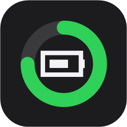
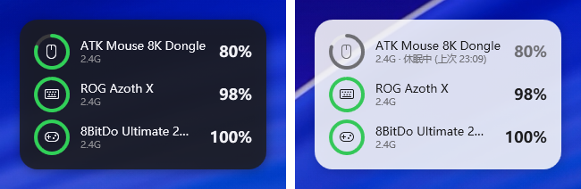

<p align="center">
  
</p>

<h1 align="center">BatteryRings</h1>

<p align="center">
  在 Windows 桌面上显示鼠标、键盘、手柄、耳机等无线设备的电量，风格参考 macOS 的"电池"小组件。<br>
  中文 | <a href="README.en.md">English</a>
</p>

<p align="center">
  
</p>

## 特点

- **一个小组件显示所有设备**：蓝牙设备，以及 Windows 本身读不到电量的 2.4G 接收器设备
- **不用装驱动、不用管理员权限**：只用 Windows 自带的 PowerShell，体积不到 100 KB
- **安全**：只发送已知的只读查询命令，不修改任何设备设置
- **充电识别**：设备上报充电状态时直接显示；不上报的，根据电量上升自动推测
- **低电量提醒**：电量低于设定值时弹出 Windows 通知
- **深色 / 浅色外观**：可以跟随系统自动切换；大小、不透明度都能调
- **贴心**：设备休眠时显示上次的电量，动一下鼠标或按一下键盘就立刻更新；托盘图标悬停就能看到所有电量；支持开机自启
- **自动更新**：有新版本时提醒，点一下就能更新
- **中英文界面**：跟随系统语言，也可以手动切换

## 支持的设备

| 类型 | 设备 | 充电识别 | 说明 |
|---|---|---|---|
| 蓝牙 / 蓝牙 LE | 耳机、鼠标、键盘、手柄等 | 推测 | 和 Windows 设置里显示的电量一致 |
| 罗技 Logitech | Unifying / Bolt / Lightspeed 接收器，以及有线、蓝牙连接的鼠标和键盘（MX、G 系列等） | ✅ | 🧪 待验证 |
| 雷蛇 Razer | HyperSpeed 无线鼠标、键盘（Viper、DeathAdder、Basilisk、BlackWidow 等） | ✅ | 🧪 待验证 |
| 索尼 PlayStation | DualSense、DualSense Edge、DualShock 4（USB / 蓝牙） | ✅ | 🧪 待验证 |
| ASUS ROG | Omni 接收器连接的鼠标和键盘（Harpe、Keris、Gladius、Azoth、Strix Scope、Falchion 等） | ✅ | 2.4G |
| Compx / Nordic 方案鼠标 | ATK、VXE、VGN、Scyrox、Dareu、G-Wolves、Zaopin 等 | ✅ | 2.4G 和有线 |
| 8BitDo | Ultimate 2 等 | 推测 | 2.4G |
| C-Media 方案耳机 | 使用 C-Media XearONE 驱动的 USB 耳机 | ✅ | 实验性 |
| XInput 手柄 | Xbox 及兼容手柄 | 推测 | Windows 只提供 4 档，显示为估算值 |
| 笔记本 | 本机电池 | ✅ | |

**充电识别：** ✅ 表示设备会直接上报充电状态。"推测"表示协议本身不带充电状态，程序会观察电量变化：30 分钟内上升 2% 以上就显示"充电中（推测）"，充到 100% 显示"已充满"。

**🧪 待验证：** 协议参考了成熟的开源项目（Solaar、OpenRazer、Linux 内核），但作者手上没有这些设备，还没在真机上测试过。如果你有这些设备，欢迎在 [Issue](../../issues) 里反馈能不能用，请附上 `-Diag` 诊断信息。

你的设备不在列表里？请看[怎么添加新设备](#添加新设备)。

## 安装

**系统要求**：Windows 10 或 Windows 11，不需要另外安装任何软件。

1. 打开 [Releases](../../releases) 页面，下载最新版的 `BatteryRings.zip`
   （或者点本页上方绿色的 **Code** 按钮 → **Download ZIP**）
2. 在下载的 ZIP 文件上点右键 → **全部解压缩**
3. 打开解压出来的文件夹，双击 **`Install.cmd`**
   - 如果弹出"打开文件 - 安全警告"，点 **运行**
   - 如果弹出"Windows 已保护你的电脑"，点 **更多信息** → **仍要运行**
4. 问"是否开机自动启动"时，直接按回车（默认"是"）

安装完成后，小组件会出现在屏幕右上角。以后也可以在开始菜单里找到 **BatteryRings** 打开。

> 程序安装在 `%LOCALAPPDATA%\Programs\BatteryRings`，只对当前用户生效。解压出来的文件夹在安装完成后可以删掉。

## 使用

| 操作 | 效果 |
|---|---|
| 左键拖动 | 移动小组件，位置会自动记住 |
| 右键小组件，或右键托盘图标 | 打开设置菜单（见下表） |
| 左键托盘图标 | 把小组件提到最前面 |
| 鼠标悬停在托盘图标上 | 显示所有设备的电量 |
| 鼠标悬停在某个设备上 | 显示完整的设备名称和数据来源 |

### 设置

| 菜单项 | 选项 | 默认 |
|---|---|---|
| 外观 | 跟随系统 / 深色 / 浅色 | 跟随系统 |
| 大小 | 小 / 中 / 大 | 中 |
| 不透明度 | 60% / 75% / 85% / 100% | 85% |
| 刷新间隔 | 5 秒 / 10 秒 / 30 秒 / 1 分钟 / 5 分钟 / 自定义（5–3600 秒） | 1 分钟 |
| 低电量提醒 | 关闭 / 10% / 20% / 30% | 20% |
| 隐藏设备 | 勾选不想显示的设备 | 都显示 |
| 显示休眠设备 | 开 / 关 | 开 |
| 锁定位置 | 开 / 关，防止误拖 | 关 |
| 置顶显示 | 开 / 关 | 关（待在其他窗口后面） |
| 开机自动启动 | 开 / 关 | 安装时选择 |
| 语言 | 跟随系统 / 中文 / English | 跟随系统 |
| 检查更新 / 自动检查更新 | 立即检查 / 开 / 关 | 开（每天一次） |

2.4G 设备休眠时接收器不会回应，这时会用灰色显示上次读到的电量。

## 性能

| 指标 | 数值 |
|---|---|
| 内存（任务管理器显示的值） | 约 25 MB |
| CPU | 1 分钟间隔：约占一个核心的 0.16%；5 秒间隔：约 0.9% |
| 磁盘 / 网络 | 只在检查更新时访问 github.com（每天一次，可以关闭）；配置文件最多每分钟写入一次，只有几 KB |

读取设备在后台线程进行，界面不会卡顿。为了让高频刷新也足够轻：

- **插拔设备时立即刷新**：接收器插上、蓝牙设备连上时 1～2 秒内就会显示，不用等下一次刷新
- **休眠设备一动就刷新**：有设备在休眠时，只要动一下鼠标或按一下键盘就立刻重新查询；设备一直不醒时，重试间隔会从 3 秒逐步放宽到 60 秒
- **设备列表缓存**：只在设备变化时重新枚举
- **休眠设备退避**：设备没有回应时，15 秒内不再重复等待它超时
- **数据没变就不重绘**：也不重复写文件

## 更新

小组件每天会检查一次 GitHub 上的最新版本。有新版本时会弹出通知，右键菜单最上面会出现 **⬆ 更新到 vX.Y.Z**，点一下就会自动下载、安装并重启，设置会保留。不想自动检查，可以在右键菜单里关掉"自动检查更新"。

## 卸载

在开始菜单里打开 **Uninstall BatteryRings**；或者双击解压文件夹里的 `Uninstall.cmd`。

## 命令行（进阶）

```powershell
cd "$env:LOCALAPPDATA\Programs\BatteryRings"
powershell -ExecutionPolicy Bypass -File .\BatteryRings.ps1           # 在终端里显示一次
powershell -ExecutionPolicy Bypass -File .\BatteryRings.ps1 -Watch    # 每 30 秒刷新
powershell -ExecutionPolicy Bypass -File .\BatteryRings.ps1 -Json     # 输出 JSON，方便其他程序调用
powershell -ExecutionPolicy Bypass -File .\BatteryRings.ps1 -Diag     # 诊断信息（提 Issue 时使用）
```

其他参数：`-Lang zh|en`、`-NoGatt`（跳过 BLE GATT 读取，更快）、`-ProbeCMedia`。

## 常见问题

**设备显示"休眠/未连接"？**
动一下鼠标或按一下键盘，再右键 → 立即刷新。

**蓝牙设备没有显示？**
先打开 Windows 设置 → 蓝牙和其他设备，看看那里有没有显示电量。如果那里也没有，说明设备没有向 Windows 上报电量。

**杀毒软件报毒？**
程序是纯文本的 PowerShell 脚本，所有代码都可以直接打开查看。有些杀毒软件会对"后台运行的 PowerShell"比较敏感，加入信任即可。

## 添加新设备

每种协议是 [`src/providers/`](src/providers) 下的一个独立文件，添加新设备不需要改动其他代码。

- **你只是用户**：按 [CONTRIBUTING.md](docs/CONTRIBUTING.md) 生成一份诊断信息，提交 [Issue](../../issues/new)
- **你想自己适配**：协议格式见 [PROTOCOLS.md](docs/PROTOCOLS.md)。抓包可以用 [`tools/hidapi_proxy`](tools/hidapi_proxy)

## 致谢

协议格式参考了这些项目（只参考了协议，没有复制代码）：

- [seerge/g-helper](https://github.com/seerge/g-helper)：ASUS ROG 外设
- [pwr-Solaar/Solaar](https://github.com/pwr-Solaar/Solaar)：罗技 HID++
- [openrazer/openrazer](https://github.com/openrazer/openrazer)：雷蛇
- Linux 内核 [hid-playstation](https://github.com/torvalds/linux/blob/master/drivers/hid/hid-playstation.c)：索尼手柄
- [Fan4Metal/mouse_tray](https://github.com/Fan4Metal/mouse_tray)：Compx / Nordic 方案鼠标
- [MiguelSanzBr/8bitdo-ultimate2-linux](https://github.com/MiguelSanzBr/8bitdo-ultimate2-linux)：8BitDo

## 许可证

[GPL-3.0](LICENSE)

本项目与文中提到的任何品牌都没有关联。所有商标归各自所有者所有。
